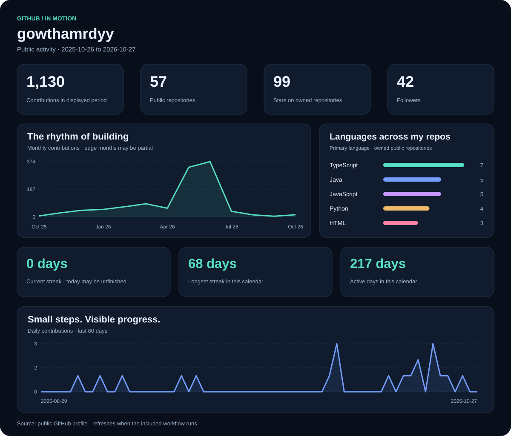
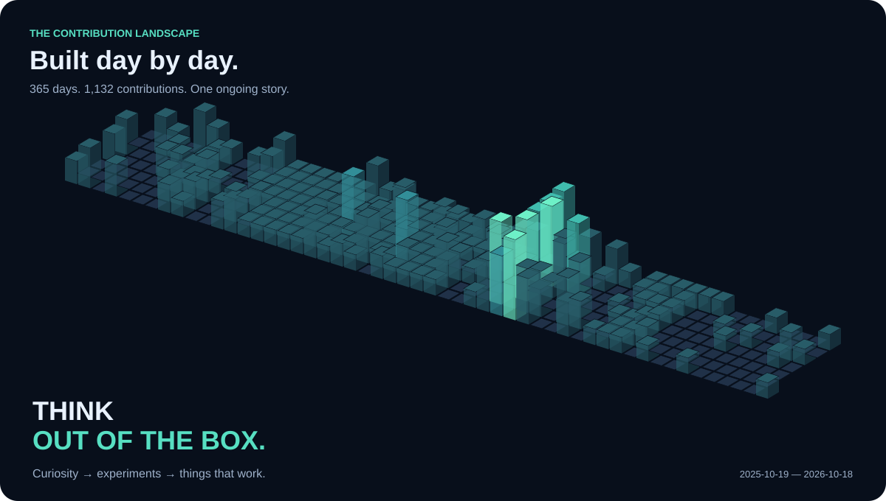

  

  <a href="https://gowthamrdyy.vercel.app/">Portfolio ↗</a> &nbsp; · &nbsp;
  <a href="https://www.linkedin.com/in/gowthamrdyy/">LinkedIn ↗</a> &nbsp; · &nbsp;
  <a href="mailto:iamgowthamsree@gmail.com">Say hello ↗</a>

  

  

<table>
<tr>
<td width="32%"></td>
<td>
<h3>A little beyond the graph.</h3>

I'm Gowtham, a Computer Science &amp; AI/ML student at SRMIST. I enjoy building useful tools, exploring how things work, and sharing what I learn.

<b>Build. Learn. Repeat.</b>

Previously: Frontend Developer at CodeAlpha. Also into: open source, AI experiments, and making videos.

</td>
</tr>
</table>

<b>A few things I've built</b>  
<a href="https://github.com/gowthamrdyy/SreeBase">SreeBase · a database from scratch</a> 
<a href="https://github.com/gowthamrdyy/InfinityDrive">InfinityDrive · your cloud accounts together</a> 
<a href="https://shortlistdd.vercel.app/">Shortlistd Pro · a simpler job search</a>

Think out of the box. Then build what you find.

